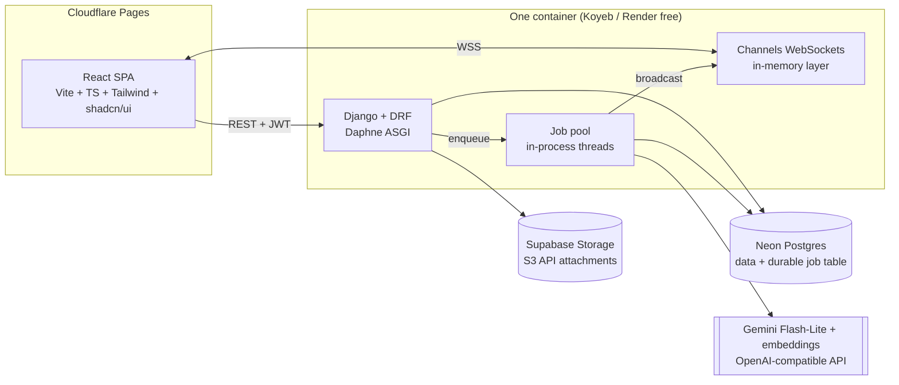

# Helpdesk AI

A multi-workspace support desk where AI does the first pass: it triages every ticket, spots duplicates and sentiment, and drafts a reply **grounded in the workspace's own knowledge base, with citations**. Agents stay in control; customers get a clean portal with self-service suggestions.

> "Helpdesk AI" is a working name. Search-and-replace it (README, `SPECTACULAR_SETTINGS`, frontend title) to rebrand.

| | |
|---|---|
| **Live demo** | _add your Cloudflare Pages URL_ (one click creates a private, pre-filled sandbox) |
| **API + Swagger** | _add your API URL_`/api/docs/` |
| **Architecture write-up** | [docs/ARCHITECTURE.md](docs/ARCHITECTURE.md) |

## Try it in 10 seconds
Click **Try the demo** and pick a template (SaaS analytics, internal IT helpdesk, or an online store). You get your own sandbox workspace with ~50 tickets, a knowledge base, a month of analytics history and AI results already attached. Switch between the **Agent view** and the **Customer view** to see both sides. Sandboxes are isolated and deleted after 24 hours.

## Features
**For customers (requesters)**
- Portal with their items (orders, subscriptions, devices...), ticket history, live updates and notifications
- Self-service suggestions from the knowledge base while typing a ticket (keyword retrieval, costs no AI quota)
- Reply, confirm or reopen a resolution, rate the support (CSAT)

**For agents and admins**
- Prioritised queue: filters, saved views, SLA countdowns, keyboard navigation, collision warnings
- **AI triage card**: category, priority, sentiment, one-line summary, confidence and reasoning. Staff overrides always win and are tracked
- **RAG drafts with citations**: the draft shows which knowledge-base articles it used; "Use this draft", regenerate, edit, send
- Possible-duplicate detection (embedding similarity), internal notes, macros, assignment, activity timeline
- Analytics: volume, first-response and resolution times, SLA breach rate, sentiment, CSAT, AI override rate, tokens, cost, latency, draft accept/edit rate
- Knowledge-base editor with a search box that runs the same retrieval the AI uses

**Platform**
- Real multi-tenancy: sign up and get your own workspace; owner/admin/agent/requester roles; invites
- Per-workspace categories, SLA targets, tone and sign-off, AI on/off
- Inbound email webhook (`POST /api/v1/inbound/email/`) turns forwarded emails into tickets
- OpenAPI docs, 55+ backend tests, CI, free-tier friendly deploy

## Architecture


**Ticket lifecycle**
1. A requester submits a ticket. In the same transaction a keyword classifier assigns a provisional category and priority, so the SLA clock starts immediately.
2. After commit, a job asks the LLM to triage (category, priority, sentiment, summary) and embeds the ticket. Staff-set values are never overwritten.
3. A second job retrieves the most relevant knowledge-base chunks and drafts a reply from those plus a deterministic **fact sheet** built from the customer's profile and the linked record.
4. Every state change is broadcast to the workspace's staff group and the requester's own group. The UI refetches through the normal permission-checked REST endpoints.

### Key decisions
- **Multi-tenancy by foreign key.** Every tenant table carries a `workspace` FK; access goes through `Membership` roles. Non-members get **404, not 403**, so workspace slugs can't be probed. Isolation is covered by tests.
- **Service layer.** All business rules (state machine, SLA, assignment, AI-vs-staff precedence, broadcasts, enqueues) live in `tickets/services.py`. Views only handle HTTP.
- **Separate requester and staff serializers.** A requester's ticket structurally has no triage fields or internal notes, so a missed filter can't leak them.
- **The model phrases, Python computes.** Amounts, dates and statuses come from the fact sheet, never from the model. Internal notes never enter prompts (tested).
- **Override wins.** Staff changes to category/priority are final; the AI suggestion is stored beside it so the override rate is a live quality metric.
- **Graceful degradation.** Rule-based triage at creation; retries with backoff; a circuit breaker; hard daily budget caps; and pre-baked AI results in demo data. An AI outage changes one thing: agents write replies manually.
- **No Redis, Celery or pgvector (yet).** At demo and small-team scale they are cost and moving parts without benefit:
  - Jobs are rows in Postgres run by an in-process pool; a sweeper re-dispatches anything left after a restart. No polling worker, so serverless Postgres can scale to zero.
  - Channels uses the in-memory layer (single instance).
  - Embeddings are JSON and cosine similarity runs in Python over one workspace's chunks, with a keyword fallback.
  - **Add them when:** more than one API instance (Redis or Postgres channel layer), sustained job throughput or scheduled jobs (Celery/RQ), or tens of thousands of chunks per workspace (pgvector).

## AI strategy and free-tier budget
Provider-agnostic (OpenAI SDK; Gemini through its OpenAI-compatible endpoint). Re-verify current free-tier numbers before relying on them.

| Concern | Approach |
|---|---|
| Model | Gemini Flash-Lite for triage and drafts; `gemini-embedding-001` (768 dims) for retrieval and duplicates |
| Daily quota (~500 chat requests for the whole project on the free tier) | `AI_DAILY_CALL_CAP=400` global and `AI_WORKSPACE_DAILY_CAP=40` per sandbox; over the cap, tickets keep rule-based triage and show a clear banner |
| Cost per ticket | ~2 chat calls plus 1 embedding. $0 on the free tier; ~$0.0004 at paid `gpt-4o-mini` prices |
| Never-empty demo | Template data ships with AI results and (optionally) precomputed embeddings: `python manage.py build_demo_embeddings` |
| Caching | Drafts are cached by a hash of their inputs (prompt, facts, KB hits); query embeddings are cached for an hour |
| Observability | Every call is logged (`AIRequestLog`) with tokens, latency, cost and outcome; shown in Analytics |

## Running locally
Requirements: Python 3.12, Node 20+, Postgres 15+.
```bash
createdb helpdesk
cd backend
uv venv --python 3.12 .venv && uv pip install --python .venv/bin/python -r requirements.txt
cp .env.example .env      # add an AI key to enable live AI (optional)
.venv/bin/python manage.py migrate
.venv/bin/daphne -b 127.0.0.1 -p 8000 config.asgi:application   # API + WebSockets + job pool
```
```bash
cd frontend && cp .env.example .env.local && npm install && npm run dev   # http://localhost:5173
```
Or run API + Postgres with `docker compose up --build`.

### Tests
```bash
cd backend && DJANGO_SETTINGS_MODULE=config.settings.test .venv/bin/pytest -q tests
```
Covers auth and tenant isolation, RBAC, the ticket state machine and SLA, notifications, the AI pipeline against a mocked client (success, retry then success, outage, permanent error, bad output, circuit breaker, budget caps, cache), retrieval, duplicate detection, every demo template, and the inbound webhook.

## Free, permanent deployment
Verify each provider's current free-tier terms before you rely on them.
1. **Database: Neon.** Create a project, copy the connection string into `DATABASE_URL`.
2. **API: Koyeb or Render (free web service).** Use `backend/Dockerfile` (or `render.yaml`). Set the env vars below. Health check path: `/health/`.
3. **Frontend: Cloudflare Pages.** Root `frontend`, build `npm run build`, output `dist`, env `VITE_API_URL=https://<your-api>`; set `CORS_ALLOWED_ORIGINS` on the API to the Pages URL.
4. **Attachments: Supabase Storage** (optional): private bucket plus S3 credentials (see `.env.example`). Without them files use local disk, which is wiped on restarts.
5. **Keep warm: GitHub Actions.** Set the repository variable `API_URL`; `keepalive.yml` pings `/health/` every 10 minutes so visitors rarely see a cold start. The same endpoint re-dispatches unfinished background jobs.
6. **AI:** create a Gemini API key in Google AI Studio and set `OPENAI_API_KEY`, `AI_BASE_URL`, `AI_MODEL`, `AI_REASONING_EFFORT=none`.

### Environment variables
| Variable | Purpose |
|---|---|
| `SECRET_KEY`, `DATABASE_URL`, `ALLOWED_HOSTS`, `CORS_ALLOWED_ORIGINS` | Core Django config. Hosts from Render, Railway, Koyeb and Fly are added automatically |
| `SECURE_SSL_REDIRECT` | Default `true`; set `false` if your platform already redirects |
| `OPENAI_API_KEY`, `AI_BASE_URL`, `AI_MODEL`, `AI_REASONING_EFFORT`, `AI_EMBED_MODEL`, `AI_EMBED_DIMENSIONS` | AI provider (server side only) |
| `AI_DAILY_CALL_CAP`, `AI_WORKSPACE_DAILY_CAP`, `AI_TIMEOUT_SECONDS` | Free-tier protection and timeouts |
| `DEMO_TTL_HOURS`, `DEMO_MAX_ACTIVE`, `DEMO_START_THROTTLE` | Sandbox lifetime, capacity and rate limit |
| `INBOUND_EMAIL_SECRET` | Enables the email webhook (header `X-Inbound-Secret`); empty disables it |
| `AWS_*` | S3-compatible attachment storage |

### Inbound email
`POST /api/v1/inbound/email/` with header `X-Inbound-Secret` and JSON `{workspace, from_email, from_name, subject, body}`. It finds or creates the sender as a requester in that workspace and creates a ticket through the normal pipeline. Never active for demo workspaces. Point a provider's inbound-parse webhook (or a small Cloudflare Email Worker) at it.

## Limitations and next steps
- Single API instance by design; scaling out means a shared channel layer and a proper worker (see decisions above).
- Free hosts sleep and free-tier AI is rate limited; both are handled gracefully but not eliminated.
- Email is inbound-only; outbound notifications are in-app.
- Next: pgvector once KBs grow, an evaluation set for draft quality (triage has one: `manage.py eval_triage`), SSO, automation rules and outbound webhooks.
