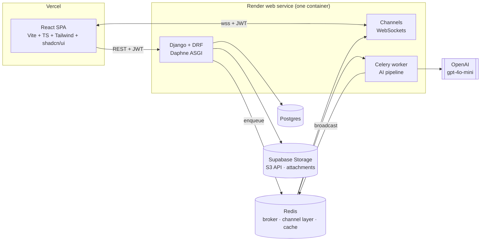

# BookLeaf Author Support & Communication Portal

A support portal for BookLeaf Publishing. Authors see their books and royalties and raise support tickets. The support team works a prioritised queue where AI does the first triage: it classifies each ticket, sets its priority, and drafts a reply in BookLeaf's tone using the knowledge base.

| | |
|---|---|
| **Live app** | `https://<your-app>.vercel.app` *(fill in after deploy)* |
| **API + Swagger** | `https://<your-api>.onrender.com/api/docs/` |
| **Write-up** | [docs/WRITEUP.md](docs/WRITEUP.md) |

### Test credentials

| Role | Email | Password |
|---|---|---|
| Author | `priya.sharma@email.com` (any of the 10 authors in the sample data) | `Author@123` |
| Admin | `admin@bookleaf.com` | `Admin@123` |
| Admin | `neha@bookleaf.com`, `kabir@bookleaf.com` | `Admin@123` |

The login page has one-click buttons that fill these in. Good edge-case authors to try:
- `sneha.kulkarni@email.com`: a book still in cover design.
- `kavita.deshmukh@email.com`: one book in typesetting, plus pending royalty below the ₹1,000 payout threshold.
- `ananya.reddy@email.com`: a book that has never been paid out.

> The Render free tier sleeps after 15 minutes of inactivity, so the first request can take about 50 seconds.

---

## What's built

### Author portal
- **Dashboard**: a greeting, royalty totals (earned, paid, pending), the next payout window, active tickets, and unread replies.
- **My Books**: title, ISBN, genre, publication date, MRP, copies sold and royalty earned/paid/pending.
  - Books in production show a 9-stage progress bar instead.
  - Contextual notes cover cases like "pending is below the ₹1,000 payout threshold" or "never paid out yet".
- **New ticket**:
  - Book dropdown (published and in-production books are grouped) plus "General / Account Level".
  - Subject, description, and up to 3 attachments (PDF/PNG/JPG/WEBP, 10 MB each) with drag-and-drop and an upload progress bar.
  - A side panel shows the selected book's facts.
  - The draft is protected against accidental navigation.
- **My Tickets**: Active / Resolved / All tabs, an unread badge, and a status timeline. Authors can reply, confirm a resolution, or reopen a ticket.
- **Real-time updates**: new replies and status changes arrive over WebSockets with a toast. If the socket drops, the page falls back to polling.
- **Notifications** (authors and admins):
  - A header bell lists unread replies with a preview. Authors also see "resolved, please confirm" items; admins see new tickets and author replies on tickets that are theirs or unassigned, with priority chips.
  - Opening a ticket clears its item, and "Mark all as read" clears the rest. The feed comes from the existing read receipts, so there's no separate notifications table to keep in sync.
  - The tab title shows the unread count, e.g. `(3) BookLeaf…`.
  - Optional desktop alerts can be switched on from the bell; they only fire while the tab is in the background.

### Admin portal
- **Queue**:
  - Ordered by priority, then age.
  - Filters for status, category, priority, date range, assignee and SLA state, plus search by text or `TKT-0001`. Filters are stored in the URL.
  - Quick views: Needs attention, Mine, Unassigned, All.
  - KPI cards; overdue tickets have a red edge and SLA countdowns ("Reply in 3h" / "Overdue 2h").
  - Keyboard navigation: `J`/`K` to move, `Enter` to open.
- **Ticket workspace**:
  - **Triage card**: shows the AI category and priority with confidence and reasoning. Both can be overridden; an override is marked "Overridden by team" and the AI never overwrites it. A "Re-run AI" button is available.
  - **Composer**: the AI draft is preloaded, editable, and shows which KB sections it used. Inline reply box with Send (Ctrl/⌘ + Enter), regenerate, and a separate **Internal notes** panel that authors never see.
  - **Mark as resolved**: a prominent header action with a confirmation dialog; the author is then asked to confirm or reopen. Authors can also mark their own open ticket resolved.
  - **Workflow**: status changes (closing asks for confirmation), assign to me or reassign (asks for confirmation if the ticket is someone else's), and the SLA state.
  - **Context**: author profile and full book and royalty facts, plus an activity timeline of every change and who made it.
  - **Collision and activity banners**: warn when another admin owns the ticket or the author replied while you were typing.
- **Analytics** for 7, 30 or 90 days:
  - Volume, average first-response and resolution times, and SLA breach rate.
  - Breakdowns by category and priority.
  - AI override rate (a proxy for classifier accuracy), AI cost, tokens, latency and failure rate.
  - How often AI drafts are sent as-is, edited, or replaced.

### SLA policy (first response)
| Priority | Target | Example |
|---|---|---|
| Critical | 4 h | Royalty unpaid for months, legal or rights issues |
| High | 24 h | Wrong ISBN or metadata live, print defects |
| Medium | 48 h | Status questions, a missing platform listing |
| Low | 72 h | Bio updates, general questions |

A ticket is "at risk" once 75% of its window has elapsed. Changing the priority recalculates the deadline.

---

## Architecture



**Ticket lifecycle**
1. An author submits a ticket. Inside the same transaction, a keyword classifier assigns a provisional category and priority, so the SLA clock starts immediately and the ticket is never untriaged.
2. On commit, a Celery task asks the LLM to classify it. The result overwrites the provisional values but never values an admin has set.
3. A second task drafts a reply using only the KB sections for that category plus a deterministic fact sheet for the author and book.
4. Every state change is broadcast to the `admins` group and to the author's own group. Authors' payloads never include triage data. The UI refetches what changed.

### Key decisions and why
- **Django + DRF.**
  - The domain is relational (authors → books → tickets → messages), and Django's ORM, migrations, admin and auth save days of work.
  - DRF provides serializers, permissions and throttling out of the box, and drf-spectacular generates the OpenAPI spec from the code, so the docs can't drift.
- **A service layer, not fat views or models.** Every business rule lives in `tickets/services.py`: transitions, SLA, the AI-vs-admin source of truth, and side effects like broadcasts and enqueues. Views only handle HTTP, and the same functions back the API, the seed command and the tests.
- **Separate author and admin serializers.** The author's view of a ticket structurally omits priority, AI reasoning, notes and activity, so a missed filter can't leak triage data.
- **AI runs asynchronously in Celery, never in the request.**
  - Ticket creation responds immediately, unaffected by OpenAI latency or outages.
  - Retries and backoff happen without a user waiting.
  - The draft is already waiting when an agent opens the ticket.
  - `transaction.on_commit` makes sure the worker never sees a half-written ticket.
- **Keyword fallback runs synchronously at creation.** There's always a category, priority and SLA deadline, even if AI never answers.
- **Django Channels WebSockets for real time.** Events are small "ticket X changed" signals; the client invalidates the relevant TanStack Query cache and refetches through the normal, permission-checked REST endpoints. Data never bypasses RBAC through the socket, and polling takes over if the socket drops.
- **Postgres and Redis.** Postgres handles relational integrity and the aggregation queries for analytics. One Redis instance serves as the Celery broker, the Channels layer, and the cache for the circuit breaker and throttles.
- **React + Vite SPA with shadcn/ui.** The UI is accessible, consistent and fully typed (TypeScript types mirror the API), and the components are owned in the repo rather than locked in a library.

### Backend layout (`backend/`)
| Path | Responsibility |
|---|---|
| `apps/accounts` | Custom `User` (email login, `AUTHOR`/`ADMIN` role), author profiles, JWT login |
| `apps/catalog` | Books, production stages, royalty rules (payout window, ₹1,000 threshold), seed command |
| `apps/tickets` | Ticket, message, attachment and activity models; **service layer** (`services.py`) holding all business rules: state machine, SLA, assignment, notes vs replies; filters; viewset |
| `apps/ai` | KB loader, prompts, classifier, drafter, keyword fallback, OpenAI client with circuit breaker and usage logging, Celery tasks |
| `apps/realtime` | JWT WebSocket middleware, consumer, broadcast helpers |
| `apps/analytics` | Aggregated metrics endpoint |
| `common/` | Error envelope, RBAC permissions, pagination |
| `knowledge_base/kb.yaml` | BookLeaf policies, tone guidelines, category→section map, example responses |

### API conventions
- Every endpoint requires a JWT except `auth/login` and `auth/refresh`. Access tokens last 30 minutes and refresh tokens 7 days; the SPA refreshes automatically.
- **RBAC** is enforced on both permissions and querysets. An author requesting another author's ticket or book gets **404**, not 403, so IDs don't leak. Admin-only actions return 403 for authors.
- Errors always use one shape:
  ```json
  { "error": { "code": "validation_error", "message": "subject: Ensure this field has at least 5 characters.", "details": { "subject": ["..."] } } }
  ```
- Invalid status transitions return `409 conflict`. Throttles apply to ticket creation, AI regeneration and login.
- Docs: Swagger UI at `/api/docs/`, raw schema at `/api/schema/`, and a static copy at [`docs/openapi.yaml`](docs/openapi.yaml).

| Endpoint | Who | Purpose |
|---|---|---|
| `POST /api/v1/auth/login/` · `refresh/` · `GET me/` | all | JWT auth |
| `GET /api/v1/books/` · `books/{id}/` · `me/summary/` | author (admin: all books) | Books, royalties, dashboard summary |
| `GET/POST /api/v1/tickets/` · `GET /tickets/{id}/` | author: own · admin: all | List/create/detail |
| `PATCH /tickets/{id}/` · `POST assign-to-me/` | admin | Status, category, priority, assignee overrides |
| `GET/POST /tickets/{id}/messages/` | both (notes: admin only) | Replies and internal notes |
| `POST /tickets/{id}/confirm-resolution/` · `mark-seen/` | author / both | Close the loop, read receipts |
| `GET /tickets/notifications/` · `POST notifications/mark-all-read/` | both (scoped to the caller) | Notification bell feed |
| `GET /tickets/{id}/draft/` · `POST draft/regenerate/` · `POST reclassify/` | admin | AI draft and classification |
| `GET /tickets/{id}/attachments/{aid}/` | ticket participants | Authorised download link (5-minute signed URL) |
| `GET /tickets/stats/` · `/admin/analytics/summary/` · `/admin/agents/` | admin | Queue counts, analytics, assignee list |
| `ws(s)://…/ws/events/?token=<access>` | both | Real-time events |

---

## AI strategy

### Model: `gpt-4o-mini`
- **Fit for the job**: both tasks are short, well-specified text tasks (6-way classification and a ~150-word templated reply), not open-ended reasoning, so a frontier model would add cost and latency without a visible quality gain.
- **Structured outputs**: strict `json_schema` mode means the classifier returns a valid enum every time, with no free-text parsing.
- **Cost**: \$0.15 per million input tokens and \$0.60 per million output tokens (see the budget below).
- **Latency**: about 1–2 s per call, so the draft is usually ready before an agent opens the ticket.
- **Swappable**: the model is set by the `AI_MODEL` env var, and every draft and log row records the model and `PROMPT_VERSION`.

### Classification (`apps/ai/classifier.py`, `prompts.py`)
- The system prompt defines the 6 categories with boundary rules, for example "royalty *amount* questions are Royalty, not General".
- It also includes a priority rubric with examples, and the rule that author frustration can raise priority by at most one level and never lowers it.
- It receives only the subject, the description (truncated) and a one-line book summary (status, pending royalty, last payout). It does **not** receive the KB, which keeps it at about 640 tokens.
- Settings: temperature 0, at most 150 output tokens. The output is validated with Pydantic and returns category, priority, confidence and a one-sentence reason shown to the agent.

### Response drafting (`apps/ai/drafter.py`)
- **KB scoping**: `kb.yaml` maps each category to the policy sections it needs, so a royalty ticket gets the royalty policy and not the printing SLA. This keeps prompts focused (about 800–1,000 tokens) and stops the model mixing up policies as the KB grows.
- **Example guidance**: the brief's "how BookLeaf handles similar queries" table is included for the matching category as few-shot style guidance.
- **Deterministic fact sheet**: Python computes the facts and the model only phrases them, so numbers are never hallucinated. Facts include the exact royalty amounts, last payout date, next payout window ("Q3 2026 payouts by 14 Nov 2026"), whether pending is below the threshold, and the production stage index.
- **Tone**: the tone guidelines sit in the system prompt with explicit rules:
  - Greet by first name and acknowledge the concern before explaining.
  - Commit to concrete timelines from policy.
  - Own BookLeaf's mistakes.
  - Never invent tracking IDs or payment references.
  - No mention of AI or internal notes.
  - A fixed sign-off.
- **Conversation**: only the last 3 *non-note* messages are included. Internal notes never reach the prompt (covered by a test).
- **Agent stays in control**: the draft is only a pre-fill. The agent edits it and sends it, and the message records whether the AI draft was sent as-is or edited (shown in analytics).

### Graceful degradation
| Failure | Behaviour |
|---|---|
| No API key / `AI_ENABLED=false` | Keyword classifier runs; the composer shows "AI drafting is off" and agents write manually |
| Timeout, 429, 5xx | Celery retries with exponential backoff (5s, 10s, 20s), then marks the ticket *Needs triage* (amber banner) and keeps the keyword classification |
| 5 consecutive failures | **Circuit breaker** opens for 5 minutes and calls are skipped immediately instead of piling up |
| Bad request / invalid JSON / schema violation | Not retried; falls back immediately |
| Redis/broker down | Ticket creation still succeeds and AI is marked failed, so the request never errors |

The keyword fallback is not a stub. It uses weighted word-start matching plus regex rules for critical and high signals (for example "not received … 6 months" or "blurry/misaligned"), and it classifies all six of the brief's example queries correctly (see `tests/test_domain.py`).

### Cost awareness
- Classification uses about 640 input and 60 output tokens. A draft uses about 900 input and 250 output tokens. That is **≈ \$0.0005 per ticket, or ≈ \$0.50 per 1,000 tickets**.
- **Drafts are cached** by a hash of their inputs (category, conversation and facts). Reopening a ticket or refreshing costs nothing; a new draft is generated only when something relevant changes.
- Drafts are generated in the background once per ticket, not on every page view.
- Regenerate and reclassify are throttled to 30 per hour per user.
- Token caps: 150 for classification, 450 for drafts. Long descriptions are truncated.
- Every call is logged in `AIRequestLog` with tokens, cost, latency, outcome and prompt version, and appears on the Analytics page.

### Security
`OPENAI_API_KEY` is read from the environment on the server only. The frontend never calls OpenAI and its bundle contains no secrets; its only env var is the public API URL. `.env` files are gitignored, and `.env.example` documents every variable without values.

---

## Running locally

**Requirements:** Python 3.12, Node 20+, Postgres 15+, Redis 7+.

On macOS:
```bash
brew install postgresql@16 redis uv && brew services start postgresql@16 redis
createdb bookleaf
```

### Backend
```bash
cd backend
uv venv --python 3.12 .venv && uv pip install --python .venv/bin/python -r requirements.txt
# or: python3.12 -m venv .venv && .venv/bin/pip install -r requirements.txt
cp .env.example .env                    # add an AI key to enable AI (see "AI provider" below)
.venv/bin/python manage.py migrate
.venv/bin/python manage.py seed_bookleaf --with-sample-tickets
.venv/bin/daphne -b 127.0.0.1 -p 8000 config.asgi:application        # API + WebSockets
.venv/bin/celery -A config worker --pool=threads --loglevel=info     # second terminal: AI pipeline
```

### AI provider
The client speaks the OpenAI Chat Completions API, so any compatible provider works by changing env vars only:

| Provider | `OPENAI_API_KEY` | `AI_BASE_URL` | `AI_MODEL` | `AI_REASONING_EFFORT` |
|---|---|---|---|---|
| OpenAI (default) | OpenAI key | *(empty)* | `gpt-4o-mini` | *(empty)* |
| Google Gemini (free tier) | key from [AI Studio](https://aistudio.google.com/apikey) | `https://generativelanguage.googleapis.com/v1beta/openai/` | `gemini-3.8-flash` | `none` |

Gemini models think before answering; `AI_REASONING_EFFORT=none` keeps that hidden reasoning from using up the 150/450 token caps. On the free tier, set `AI_PRICE_INPUT_PER_M=0` and `AI_PRICE_OUTPUT_PER_M=0` so the analytics cost reads $0.

Without a key, the app runs on the keyword fallback and shows that AI is off.

### Frontend
```bash
cd frontend
cp .env.example .env.local
npm install
npm run dev        # http://localhost:5173
```

### Tests
```bash
cd backend && .venv/bin/pytest      # 56 tests
```
The tests cover:
- Authentication and RBAC scoping, including 404 for other users' data.
- Internal-note isolation in both the API and the AI prompt.
- Validation and the error envelope, attachment rules, the state machine, SLA recalculation, and admin overrides winning over AI.
- The full AI pipeline with a mocked OpenAI client: success, retry then success, persistent outage, permanent error, invalid model output, the circuit breaker, AI disabled, and the draft cache.
- Fallback accuracy on the brief's examples, payout-window maths, and seed idempotency.

---

## Deployment

**Backend on Render** (`render.yaml` blueprint, free tier):
- The blueprint creates the web service, Postgres and Redis (Key Value).
- `backend/start.sh` runs migrations, optionally seeds, starts the Celery worker in the background (thread pool, low memory), and then runs Daphne in the foreground.
- Running the worker in the same container avoids needing a paid background-worker plan.
- Set these secrets in the dashboard:
  - `OPENAI_API_KEY`, plus `AI_BASE_URL` and `AI_MODEL` (see "AI provider")
  - `CORS_ALLOWED_ORIGINS` (the Vercel URL)
  - the `AWS_*` variables for attachment storage (see below)
- `SEED_ON_START=true` seeds the demo data idempotently.

**Frontend on Vercel**: set the root directory to `frontend`, the framework to Vite, and the env var `VITE_API_URL=https://<api>.onrender.com`. `vercel.json` handles SPA routing.

**Attachments**: the demo uses **Supabase Storage** (free tier, no card) through its S3-compatible API, via `django-storages`. Any S3-compatible store (AWS S3, Cloudflare R2, Backblaze B2) works by changing only the env vars.
- Files are private objects in a private bucket.
- Downloads go through an authorised endpoint that checks the user can see the ticket, then returns a signed URL that expires after 5 minutes.
- Without `AWS_STORAGE_BUCKET_NAME`, files go to local disk, which is fine locally but wiped on every Render restart.

Supabase setup:
1. Create a project, then a **private** bucket named `attachments`.
2. Go to *Project Settings → Storage → S3 Connection*, enable it, and create an access key.
3. Set these variables:
   - `AWS_STORAGE_BUCKET_NAME=attachments`
   - `AWS_ACCESS_KEY_ID` and `AWS_SECRET_ACCESS_KEY`
   - `AWS_S3_ENDPOINT_URL=https://<ref>.supabase.co/storage/v1/s3`
   - `AWS_S3_REGION_NAME=<project region>`
   - `AWS_S3_ADDRESSING_STYLE=path`

---

## Edge cases handled
- Books in production have no ISBN, sales or royalty. The UI shows stage progress instead of zeros, and the AI's fact sheet says the book isn't live yet.
- Pending royalty below ₹1,000 rolls over: the UI shows a note, and the AI explains the threshold instead of promising a payout.
- Books that were never paid out, or fully paid, get specific copy.
- General tickets with no book get account-level facts only.
- An author replying to a resolved ticket reopens it and refreshes the AI draft. Authors can also confirm a resolution, which closes the ticket.
- A category override regenerates the draft with the right KB sections. A priority override recalculates the SLA.
- Two admins on one ticket see a collision banner, and reassigning someone else's ticket asks for confirmation.
- Composer text survives reloads (stored in localStorage) and is never overwritten by a late-arriving draft.

## Known limitations / next steps
- On the free tier, the worker shares the web dyno and the service sleeps when idle. In production the worker would be a separate service with autoscaling.
- There's no email notification channel yet; real-time updates are in-app only.
- The KB is a version-controlled YAML file. A larger KB would move to a database with an admin editor and embedding retrieval, and the category scoping would become a pre-filter.
- Classification quality is tracked through the override rate. A labelled evaluation set and prompt A/B tests (using `prompt_version`, already logged) would be the next step.
